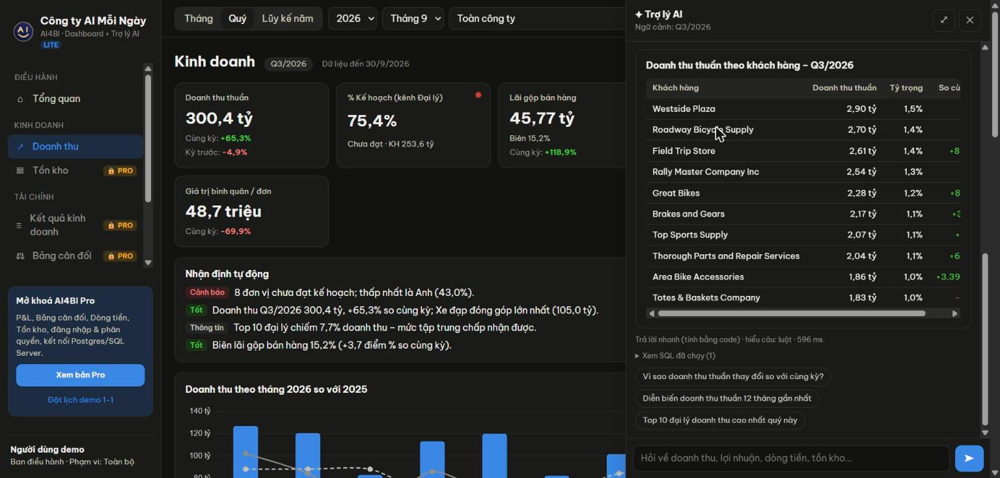

<div align="center">

# 📊 AI4BI Lite — Dashboard điều hành + Trợ lý AI tiếng Việt

**Hỏi bằng tiếng Việt, nhận đúng con số trên dashboard. Không bịa số liệu (Zero Hallucination).**

[](https://github.com/ai4bi-enterprise/ai4bi/actions/workflows/ci.yml)
[](https://github.com/ai4bi-enterprise/ai4bi/releases)
[](LICENSE)


[](https://ai4bi-demo.onrender.com/#/sales)

[**⚡ Chạy thử trong 60 giây**](#-chạy-thử-trong-60-giây) · [**💎 So sánh Lite / Pro / Enterprise**](#-so-sánh-phiên-bản) · [**📅 Đặt lịch demo 1-1**](https://calendly.com/ai4bi-contact/demo)

</div>



---

## 🎯 Vì sao Text-to-SQL thông thường thất bại trong doanh nghiệp?

Cho LLM tự viết SQL thì mỗi lần hỏi có thể ra một con số khác: sai bảng, quên lọc, cộng trùng. Ban điều hành chỉ cần **một lần số sai** là không bao giờ dùng lại.

AI4BI làm ngược lại:

| | Text-to-SQL thông thường | **AI4BI** |
|---|---|---|
| Ai viết SQL? | LLM | **Code**, từ lớp ngữ nghĩa (Semantic Layer YAML) |
| Con số trong câu trả lời | LLM tự sinh | **Lấy từ đúng hàm dựng dashboard** – chatbot = dashboard |
| Lời nhận xét | Tuỳ LLM | Qua **cổng kiểm số**: câu có con số không nằm trong bằng chứng bị chặn |
| Không có API key | Không chạy | **Vẫn chạy** bằng bộ hiểu câu theo luật |

## ✨ Bản Lite có gì

- **Dashboard Tổng quan + Doanh thu**: KPI, so cùng kỳ / kế hoạch, xu hướng 12 tháng, theo khu vực – đơn vị – kênh – nhóm hàng, top đại lý / sản phẩm, nhận định tự động.
- **Trợ lý AI tiếng Việt** (panel bên phải hoặc toàn màn hình): hỏi con số, tách theo chiều, xếp hạng, xu hướng, *“Vì sao doanh thu giảm?”*.
- **Lớp ngữ nghĩa YAML** (`app/semantic/`): định nghĩa chỉ số một lần, dashboard và chatbot cùng dùng.
- **Dữ liệu mẫu có sẵn**: ~97.000 dòng bán hàng, 10 đơn vị, 01/2024–09/2026 (dựng từ Microsoft AdventureWorks DW, MIT). Không cần cài CSDL.
- **LLM tuỳ chọn**: Anthropic → OpenAI → Gemini (tự chuyển khi hãng lỗi). Không có key vẫn trả lời đúng số.
- Giao diện sáng / tối, chạy tốt trên điện thoại.

## ⚡ Chạy thử trong 60 giây

👉 **Không muốn cài?** Mở [Live Demo](https://ai4bi-demo.onrender.com/#/sales) ngay trên trình duyệt. Máy chủ miễn phí tự ngủ khi vắng khách, lần mở đầu có thể mất khoảng 1 phút.

**Windows:** tải repo rồi nhấp đúp `run_demo.bat`.
**Mac / Linux:**

```bash
git clone https://github.com/ai4bi-enterprise/ai4bi.git
cd ai4bi
./run_demo.sh            # tạo .venv, cài thư viện, mở http://localhost:8000
```

**Docker:**

```bash
docker build -t ai4bi-lite .
docker run --rm -p 8000:7860 ai4bi-lite     # mở http://localhost:8000
```

Muốn dùng LLM: sao chép `.env.example` thành `.env`, điền một trong `ANTHROPIC_API_KEY` / `OPENAI_API_KEY` / `GEMINI_API_KEY`.

### Câu hỏi mẫu

- Doanh thu quý này so với cùng kỳ và kế hoạch
- Doanh thu theo khu vực năm 2025
- Top 5 đại lý doanh thu cao nhất
- Vì sao doanh thu thay đổi so với cùng kỳ?

## 🏗️ Kiến trúc

```
Câu hỏi ─► Hiểu câu (luật hoặc LLM) ─► Phiếu truy vấn (JSON) ─► Kiểm tra: chỉ số / chiều / kỳ / phạm vi
                                                                      │
Dashboard ◄─ cùng hàm dựng khối ◄─ Semantic Layer (YAML) ─► SQL chỉ đọc ─► SQLite / CSDL của bạn
                                                                      │
Trả lời ◄─ Cổng kiểm số (chặn số không có trong bằng chứng) ◄─ Lời nhận xét (luật hoặc LLM)
```

- `app/semantic/*.yaml` – chỉ số, chiều, nguồn dữ liệu.
- `app/modules/` – mỗi phân hệ dashboard là 1 file đăng ký vào registry.
- `app/chat/` – hiểu câu, thực thi, cổng kiểm số.
- `docs/DATA_CONTRACT.md` – hợp đồng dữ liệu `bi_*`: muốn chạy trên dữ liệu thật, chỉ cần tạo view theo hợp đồng này.

Kiểm thử: `pip install -r requirements-dev.txt && pytest -q`.

## 💎 So sánh phiên bản

| Tính năng | 🌱 **Lite** (repo này, miễn phí) | 🚀 **Pro** (mã nguồn đầy đủ) | 🏢 **Enterprise** (triển khai trọn gói) |
|---|---|---|---|
| Dashboard | Tổng quan, Doanh thu | + **Kết quả kinh doanh (P&L), Bảng cân đối, Lưu chuyển tiền, Tồn kho** | + phân hệ theo nghiệp vụ riêng |
| Trợ lý AI trên Semantic Layer | ✅ 12 chỉ số bán hàng | ✅ 60 chỉ số, 5 nghiệp vụ | ✅ chỉ số & từ điển nghiệp vụ riêng |
| Nhận định tự động, cổng kiểm số | ✅ | ✅ | ✅ + chuyên gia phân tích AI |
| LLM | Khoá trong `.env` | + **trang quản trị nhập khoá** (mã hoá), chọn model từng vai trò | + LLM chạy nội bộ (On-Premise) |
| Cơ sở dữ liệu | SQLite mẫu | PostgreSQL (đã chạy thật trên Neon); SQL Server, MySQL qua SQLAlchemy | ERP, MISA / Fast / Bravo, SAP B1, Odoo, Data Warehouse |
| Đăng nhập & phân quyền | 1 người dùng | ✅ **Mật khẩu + JWT, RBAC, Row-Level Security** theo đơn vị, nhật ký | ✅ + SSO / AD |
| Triển khai | Máy cá nhân, Docker | + Vercel / cloud, hướng dẫn đầy đủ | On-Premise 100%, đấu nối & đào tạo |
| Hỗ trợ | GitHub Issues | Email, cập nhật phiên bản | Theo hợp đồng |

## 💼 Mua bản Pro / Triển khai Enterprise

- **🚀 AI4BI Pro** – quyền truy cập repo private chứa toàn bộ mã nguồn (frontend, backend, đăng nhập, phân quyền, đa CSDL) và các bản cập nhật.
  👉 [Liên hệ mua bản Pro](mailto:ai4bi.contact@gmail.com?subject=AI4BI%20Pro)
- **🏢 AI4BI Enterprise** – chúng tôi đấu nối ERP / phần mềm kế toán / Data Warehouse của bạn, chuẩn hoá chỉ số cho Ban điều hành, cài đặt tại chỗ.
  👉 [Đặt lịch demo 1-1 trên dữ liệu của bạn (30 phút)](https://calendly.com/ai4bi-contact/demo)

📬 **Email:** [ai4bi.contact@gmail.com](mailto:ai4bi.contact@gmail.com)

## 🤝 Đóng góp

Mọi góp ý, báo lỗi đều được hoan nghênh – xem [CONTRIBUTING.md](CONTRIBUTING.md). Lỗ hổng bảo mật: xem [SECURITY.md](SECURITY.md).
Lịch sử thay đổi: [CHANGELOG.md](CHANGELOG.md).

## 📄 Giấy phép

[MIT](LICENSE) © Công ty AI Mỗi Ngày. Dữ liệu mẫu từ Microsoft AdventureWorks DW (MIT).
