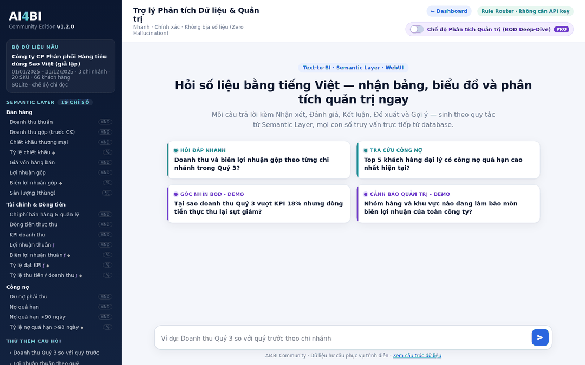
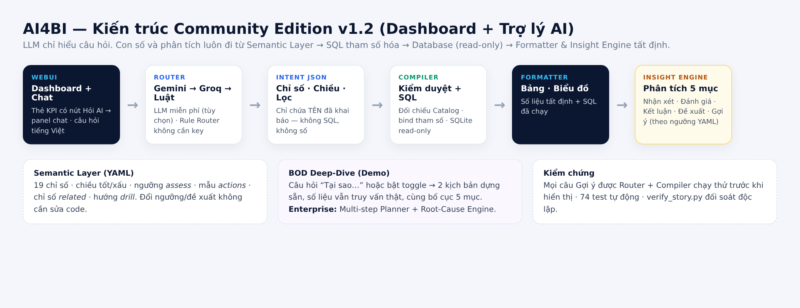
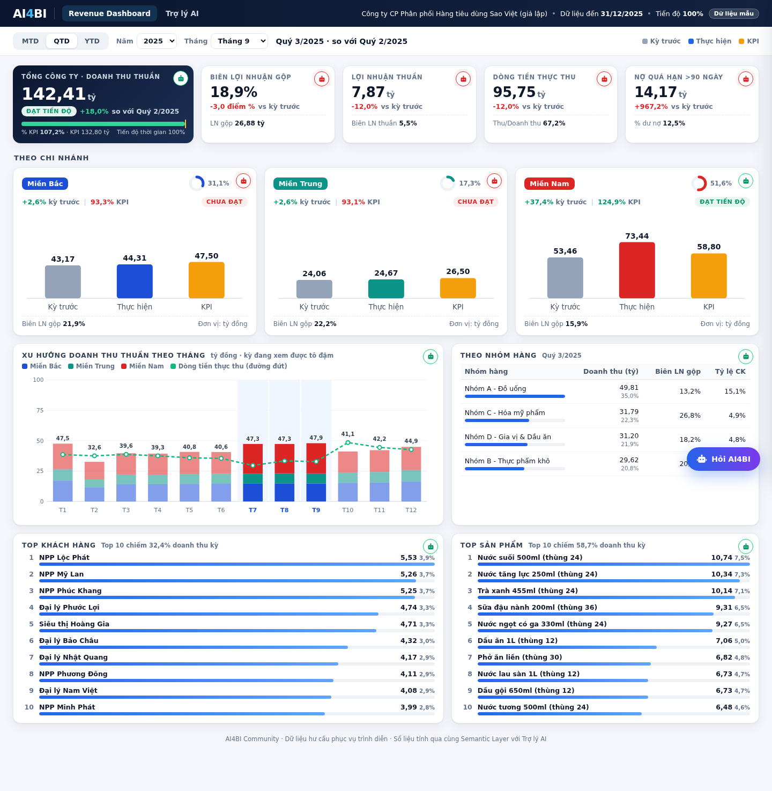
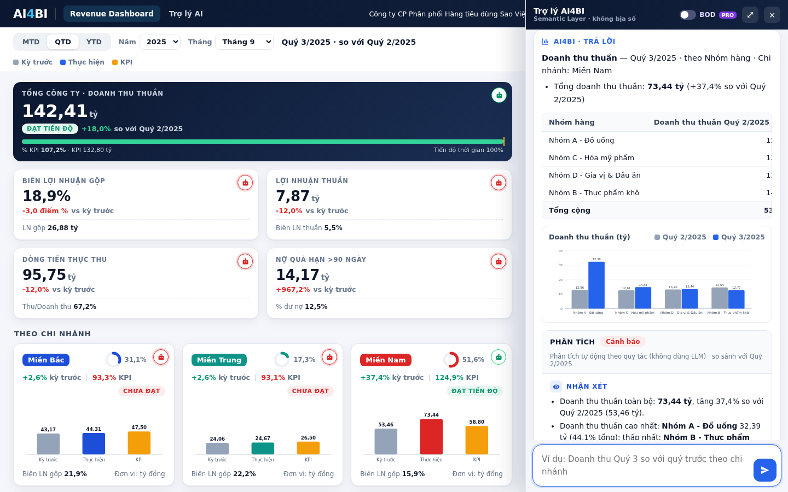
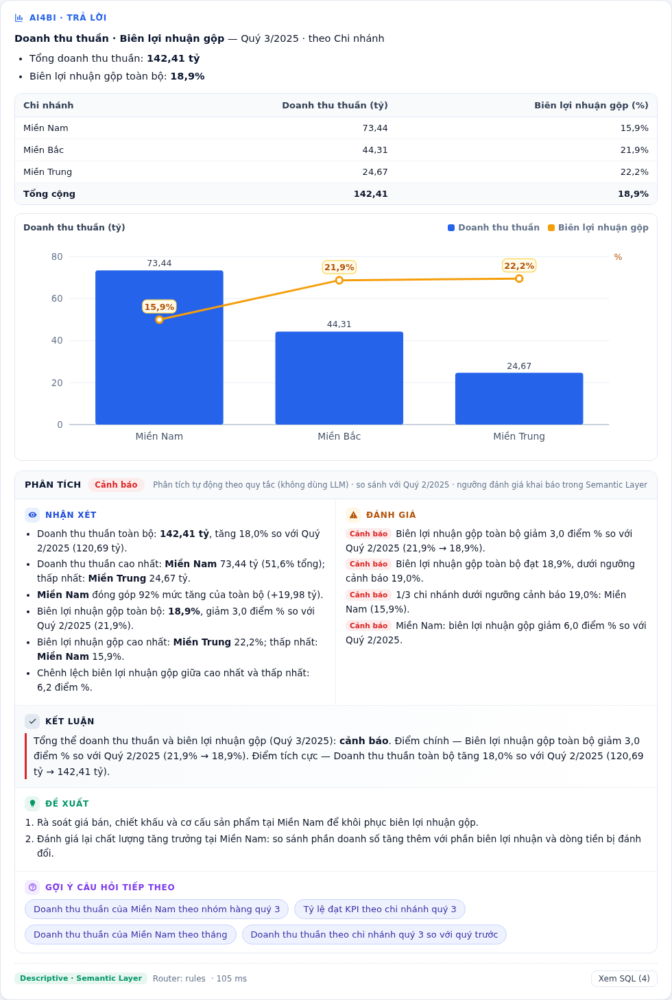
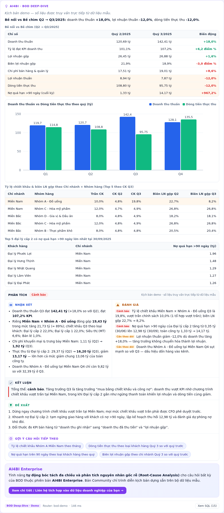

<div align="center">

# 📊 AI4BI — Enterprise Text-to-BI: Dashboard + Trợ lý AI trên Semantic Layer

**Dashboard quản trị và Trợ lý Phân tích dùng chung một lớp ngữ nghĩa: Nhanh, Chính xác, Không bịa số liệu (Zero Hallucination)**

[](https://LINK-LIVE-DEMO-CUA-BAN)
[](LICENSE)
[](#-phiên-bản-pro--dịch-vụ-triển-khai-doanh-nghiệp-commercial)



</div>

---

## 🎯 Tại sao các dự án Text-to-SQL thông thường thất bại trong doanh nghiệp?

1. **Sai lệch số liệu (Hallucination):** LLM tự join sai bảng, hiểu sai công thức Doanh thu thuần, Biên lợi nhuận, Công nợ lũy kế.
2. **Số trên chatbot khác số trên dashboard:** hai hệ thống, hai cách tính.
3. **Chỉ trả số, không trả lời “vậy thì sao?”:** thiếu nhận xét, đánh giá và hành động đề xuất cho BOD.

**AI4BI** giải quyết bằng một **Semantic Layer (YAML)** dùng chung cho cả Dashboard và Trợ lý AI:

- 🧱 **LLM không bao giờ viết SQL hay viết số.** LLM chỉ chọn *tên* chỉ số/chiều đã khai báo; SQL sinh từ YAML; câu trả lời do bộ định dạng tất định viết.
- 📈 **Dashboard = Chatbot:** mọi thẻ trên Dashboard có nút **Hỏi AI** mở panel chat với câu hỏi đúng ngữ cảnh — con số hai bên khớp tuyệt đối (có test tự động).
- 🧠 **Mỗi câu trả lời kèm 5 mục phân tích:** **Nhận xét · Đánh giá · Kết luận · Đề xuất · Gợi ý** — sinh theo quy tắc và ngưỡng doanh nghiệp tự khai báo, không dùng LLM.
- 🔎 **Kiểm chứng được:** bấm *Xem SQL* để thấy mọi truy vấn đã chạy.
- ⚡ **Chạy ngay không cần API key.** Thêm key **miễn phí** của Google Gemini / Groq để hiểu câu hỏi diễn đạt tự do.



---

## 🎥 Xem Demo Thực Tế (bộ số liệu doanh nghiệp mẫu)

Dữ liệu mẫu mô phỏng **công ty phân phối hàng tiêu dùng** (3 chi nhánh, 20 SKU, 66 khách hàng, ~510 tỷ doanh thu/năm) với một **“câu chuyện quản trị” cài sẵn** ở Quý 3/2025:

| Bề nổi (Dashboard) | Bề chìm (hỏi Trợ lý AI) |
|---|---|
| Doanh thu thuần Q3 **+18%** so với Q2, đạt **107% KPI** | Lợi nhuận thuần **−12%**, dòng tiền thực thu **−12%** |
| Miền Nam **“Đạt tiến độ”** với 125% KPI | Miền Nam chiết khấu Nhóm A **22%** (trần 10%) |
| | Nợ quá hạn >90 ngày của Đại lý cấp 2 **tăng vọt** |

**Revenue Dashboard** — thẻ KPI, thẻ chi nhánh (Kỳ trước · Thực hiện · KPI), xu hướng tháng, nhóm hàng, Top N:



**Bấm “Hỏi AI” trên thẻ Miền Nam** → panel Trợ lý AI trả lời kèm Nhận xét · Đánh giá · Kết luận · Đề xuất · Gợi ý:



| Trợ lý AI (toàn màn hình) | BOD Deep-Dive (Demo) |
|---|---|
|  |  |

👉 **Dùng thử trực tiếp trên trình duyệt:** [Mở Live Demo](https://LINK-LIVE-DEMO-CUA-BAN)

---

## ⚡ Cài đặt & Chạy thử trong 60 giây (Zero-Config)

Bản Community đi kèm `sample_data/enterprise_sample.db` (SQLite, ~2 MB). Không cần database server, **không bắt buộc API key**.

### Cách 1: Python (Windows / Mac / Linux) — Python 3.10+

```bash
git clone https://github.com/ai4bi-enterprise/ai4bi.git
cd ai4bi
cp .env.example .env        # Windows: copy .env.example .env  (tùy chọn)
pip install -r requirements.txt
python -m uvicorn app.main:app --port 8000
```

Hoặc **nhấp đúp `run_demo.bat`** (Windows) / `./run_demo.sh` (Mac/Linux).

| Địa chỉ | Màn hình |
|---|---|
| <http://localhost:8000> | Revenue Dashboard + panel Trợ lý AI |
| <http://localhost:8000/?mode=qtd&month=9> | Dashboard Quý 3 (xem “câu chuyện quản trị”) |
| <http://localhost:8000/chat> | Trợ lý AI toàn màn hình |

### Cách 2: Docker

```bash
docker build -t ai4bi-chatbot .
docker run -p 8000:7860 --env-file .env ai4bi-chatbot
```

### Bật LLM miễn phí (Gemini + Groq, không cần thẻ)

| Provider | Lấy key | Model mặc định |
|---|---|---|
| Google Gemini | [aistudio.google.com](https://aistudio.google.com) | `gemini-3.8-flash` |
| Groq | [console.groq.com](https://console.groq.com) | `openai/gpt-oss-20b` |

```ini
# .env
LLM_PROVIDERS=gemini,groq
GEMINI_API_KEY=AIza...
GROQ_API_KEY=gsk_...
```

```bash
python tools/check_llm.py      # xác nhận model ID qua /models + chấm độ chính xác 8 câu hỏi chuẩn
```

Luồng: **Gemini → Groq → Rule Router**. Hết quota (429) thì tự chuyển provider; câu hỏi lặp lại dùng cache.

> ⚠️ Free tier của Gemini có thể dùng nội dung gửi lên để cải thiện sản phẩm. Chỉ dùng với dữ liệu mẫu.

---

## 💬 Câu hỏi mẫu

| Nhóm | Câu hỏi |
|---|---|
| 🟢 Hỏi đáp nhanh | *Doanh thu và biên lợi nhuận gộp theo từng chi nhánh trong Quý 3?* |
| 🟢 Tra cứu công nợ | *Top 5 khách hàng đại lý có công nợ quá hạn cao nhất hiện tại?* |
| 🟢 So sánh kỳ | *Dòng tiền thực thu theo loại khách hàng Quý 3 so với quý trước* |
| 🟢 Xu hướng | *Tỷ lệ chiết khấu Nhóm A Miền Nam theo tháng* |
| 🟣 Góc nhìn BOD | *Tại sao doanh thu Quý 3 vượt KPI 18% nhưng dòng tiền thực thu lại sụt giảm?* |
| 🟣 Cảnh báo quản trị | *Nhóm hàng và khu vực nào đang làm bào mòn biên lợi nhuận của toàn công ty?* |

---

## 🧩 Tùy biến bằng YAML (không sửa code)

```yaml
# app/semantic_models/sales.yaml
metrics:
  bien_loi_nhuan_gop:
    label: Biên lợi nhuận gộp
    source: sales
    sql: "SUM(doanh_thu_thuan - gia_von) * 1.0 / NULLIF(SUM(doanh_thu_thuan), 0)"
    format: pct
    assess: {good: 0.21, warn: 0.19}          # ngưỡng cho mục Đánh giá
    related: [ty_le_chiet_khau, loi_nhuan_thuan]  # chỉ số gợi ý xem tiếp
    actions:                                   # mẫu cho mục Đề xuất
      bad: "Rà soát giá bán, chiết khấu và cơ cấu sản phẩm tại {worst} để khôi phục biên lợi nhuận gộp."
```

Chi tiết: [`docs/DESIGN.md`](docs/DESIGN.md) · Dữ liệu mẫu: [`sample_data/schema_overview.md`](sample_data/schema_overview.md) · Triển khai Live Demo: [`docs/DEPLOY.md`](docs/DEPLOY.md) · Lịch sử: [`CHANGELOG.md`](CHANGELOG.md)

Kiểm thử trước khi push: `pip install -r requirements-dev.txt && pytest -q` (74 ca kiểm thử).

---

## 💎 So sánh Phiên bản: Community vs. Pro / Enterprise

| Tính năng | 🌱 Community (repo này) | 🚀 Pro Boilerplate | 🏢 Enterprise (B2B) |
|---|---|---|---|
| **Dashboard + panel Trợ lý AI** | ✅ Revenue Dashboard mẫu | ✅ Full source, thêm P&L | ✅ Revenue, P&L, Cashflow, Tồn kho theo thương hiệu riêng |
| **Hỏi đáp qua Semantic Layer** | ✅ 3 gói mẫu, 19 chỉ số | ✅ Đầy đủ | ✅ Theo nghiệp vụ riêng |
| **Nhận xét · Đánh giá · Đề xuất** | ✅ Theo quy tắc & ngưỡng YAML | ✅ + ngưỡng theo đơn vị/kỳ | ✅ + chuyên gia phân tích AI |
| **Cơ sở dữ liệu** | SQLite (mẫu) | Postgres, MySQL, SQL Server | **ERP, Oracle, SQL Server, Data Warehouse** |
| **🧠 BOD Deep-Dive (Root-Cause)** | 🔒 Kịch bản demo | ✅ Module cơ bản | ✅ **AI Planner + Root-Cause Engine** |
| **Row-Level Security** | ❌ | ✅ RBAC | ✅ **SSO / AD, phân quyền chi nhánh** |
| **Xuất Excel/PDF & Local LLM** | ❌ | ✅ | ✅ **On-Premise 100%** |

---

## 💼 Phiên bản Pro & Dịch vụ Triển khai Doanh nghiệp (Commercial)

- **📦 AI4BI Pro Boilerplate** — toàn bộ mã nguồn Frontend, Backend, kết nối đa database và phân quyền.
  👉 [Mua quyền truy cập Private Repo](#)
- **🏢 Triển khai trọn gói (Turnkey B2B)** — đấu nối ERP / phần mềm kế toán / Data Warehouse, chuẩn hóa chỉ số cho BOD, triển khai On-Premise.

📬 **Liên hệ:**
- **Email:** [ai4bi.contact@gmail.com](mailto:ai4bi.contact@gmail.com)
- **Đặt lịch demo 1-1 trên dữ liệu của bạn:** [Đăng ký tại đây](LINK-GOOGLE-FORM)

---

<sub>Dữ liệu mẫu hoàn toàn hư cấu, không phản ánh bất kỳ doanh nghiệp có thật nào. Phát hành theo giấy phép MIT.</sub>
