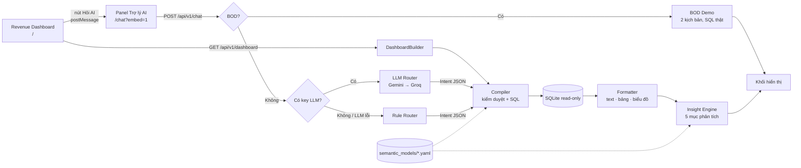

# AI4BI — Thiết kế Community Edition v1.2

## 1. Mục tiêu thiết kế

| Mục tiêu | Cách đạt được |
|---|---|
| **Zero Hallucination** | LLM chỉ chọn *tên* chỉ số/chiều/giá trị từ Catalog; SQL sinh từ YAML; số và phân tích do code tất định viết |
| **Dashboard = Chatbot** | Dashboard tính số qua chính `Compiler` của chatbot; nút *Hỏi AI* gửi câu hỏi đã kiểm chứng sang panel chat |
| **Trả lời có phân tích** | Insight Engine sinh Nhận xét · Đánh giá · Kết luận · Đề xuất · Gợi ý theo ngưỡng/mẫu trong YAML |
| **Zero-Config** | SQLite 1 file + Rule Router chạy không cần API key; WebUI build sẵn phục vụ bởi chính FastAPI |
| **Kiểm chứng được** | Mỗi câu trả lời kèm SQL; `tools/verify_story.py` đối soát độc lập; `pytest` 74 ca kiểm thử |

## 2. Kiến trúc



## 3. Revenue Dashboard

| Thành phần | Nội dung | Ghi chú |
|---|---|---|
| Header | Công ty · Dữ liệu đến · Tiến độ thời gian | Tiến độ = tỷ lệ ngày đã qua của kỳ so với ngày chốt dữ liệu |
| Control bar | MTD / QTD / YTD · Năm · Tháng | Tham số URL: `?mode=qtd&month=9` |
| Thẻ Tổng công ty | Doanh thu thuần, % so kỳ trước, % KPI, thanh tiến độ | Trạng thái: **Đạt tiến độ** (≥100% tiến độ), **Gần đạt** (95–100%), **Chưa đạt** |
| 4 thẻ KPI | Biên LN gộp · LN thuần · Dòng tiền thực thu · Nợ quá hạn >90 ngày | Màu biến động theo chiều tốt/xấu của chỉ số |
| Thẻ chi nhánh | Cột Kỳ trước · Thực hiện · KPI, donut tỷ trọng, hàng %kỳ trước \| %KPI | Dùng **chung trục Y** để so sánh quy mô giữa chi nhánh |
| Xu hướng | Cột chồng doanh thu theo chi nhánh từng tháng + đường dòng tiền thực thu | Các tháng của kỳ đang xem được tô đậm |
| Nhóm hàng, Top N | Doanh thu, biên LN gộp, tỷ lệ CK; Top 10 khách hàng/sản phẩm | |

**Quy ước kỳ so sánh:** MTD so với tháng trước; QTD so với cùng số tháng đầu quý trước; YTD không có kỳ so sánh vì dữ liệu mẫu chỉ có năm 2025.
**Quy ước KPI:** KPI chỉ có theo quý; kỳ không trọn quý dùng KPI phân bổ đều theo tháng (KPI quý ÷ 3 × số tháng) và có ghi chú trên giao diện.
**Màu chi nhánh** khai báo duy nhất tại `app/engine/dashboard.py` (`BRANCH_COLORS`); vàng dành riêng cho KPI, xám cho kỳ trước.

### Nút “Hỏi AI” và panel chat

- Mỗi thẻ có câu hỏi theo ngữ cảnh (chỉ số × chi nhánh × kỳ). Backend chỉ trả câu hỏi khi Router + Compiler xử lý được; test chạy thử **mọi** câu hỏi ở 15 tổ hợp kỳ.
- Panel là `/chat?embed=1` trong iframe cùng origin; dashboard gửi câu hỏi bằng `postMessage` (`ai4bi:ask`), đồng bộ công tắc BOD (`ai4bi:bod`), panel báo sẵn sàng (`ai4bi:ready`) và đóng bằng Esc (`ai4bi:close`). Chỉ nhận message cùng origin.
- Màn hình ≥1200px: panel nằm cạnh dashboard, nội dung tự co lại, vẫn bấm được các thẻ khác. Màn hình hẹp: panel phủ lên với nền mờ.
- Icon *Hỏi AI* viền xanh khi bình thường, viền đỏ nhấp nháy khi chỉ số xấu đi hoặc chưa đạt tiến độ.

## 4. Hợp đồng Intent (JSON)

```json
{"type": "query", "metrics": ["doanh_thu_thuan", "bien_loi_nhuan_gop"], "dimensions": ["chi_nhanh"],
 "filters": {"nhom_hang": ["Nhóm A - Đồ uống"]}, "year": 2025, "quarters": [3], "months": [],
 "compare": "prev", "order": "desc", "limit": 5}
```

Compiler từ chối (và hỏi lại) khi: chỉ số/chiều không có trong Catalog; giá trị lọc không tồn tại trong database; chỉ số không hỗ trợ chiều được hỏi; chỉ số chỉ có hạt Quý nhưng hỏi theo Tháng.

## 5. Insight Engine — Nhận xét · Đánh giá · Kết luận · Đề xuất · Gợi ý

Sinh **tất định theo quy tắc, không dùng LLM**. Mọi con số lấy từ kết quả truy vấn hoặc từ truy vấn bổ sung qua chính Compiler (hiện trong *Xem SQL*).

| Mục | Nguồn | Quy tắc chính |
|---|---|---|
| **Nhận xét** | Kết quả truy vấn | Tổng & biến động so kỳ trước; cao/thấp nhất & tỷ trọng; đối tượng đóng góp chính vào biến động; đối tượng đi ngược xu hướng; độ phân tán; đỉnh/đáy & kỳ biến động mạnh (chuỗi thời gian) |
| **Đánh giá** | `assess` + `higher_is_better` | Mức so với ngưỡng (Tích cực / Cần theo dõi / Cảnh báo); biến động (tiền tệ: ±3% / −10%; tỷ lệ: ±1 / −3 điểm %); xấu đi liên tiếp; tập trung cao; doanh thu tăng nhưng hiệu quả giảm |
| **Kết luận** | Tổng hợp Đánh giá | Trạng thái chung = mức nặng nhất; nêu điểm chính và điểm tích cực |
| **Đề xuất** | `actions.{bad,warn,good}` | Điền `{worst}`/`{best}` bằng đối tượng có vấn đề; mỗi chỉ số × đối tượng chỉ 1 đề xuất; tối đa 3 |
| **Gợi ý** | `drill` (chiều) + `related` (chỉ số) | Đào sâu đối tượng có vấn đề, chỉ số liên quan, xu hướng, so sánh kỳ trước; **chỉ hiển thị câu đã chạy thử thành công** |

Kỳ so sánh tự động: 1 quý → quý trước; 1 tháng → tháng trước; công nợ (snapshot) → ngày chốt cuối quý trước. Tắt toàn bộ: `INSIGHTS_ENABLED=false`.

## 6. Đặc tả Semantic Layer (YAML)

```yaml
sources:
  sales:
    table: v_sales          # chỉ đọc từ view v_*
    kind: period            # period: lọc nam/quy/thang | snapshot: tính tại ngày chốt :asof
    dimensions: {chi_nhanh: chi_nhanh, nhom_hang: nhom_hang, ...}

metrics:
  bien_loi_nhuan_gop:
    label: Biên lợi nhuận gộp
    source: sales
    sql: "SUM(doanh_thu_thuan - gia_von) * 1.0 / NULLIF(SUM(doanh_thu_thuan), 0)"
    format: pct
    higher_is_better: true
    assess: {good: 0.21, warn: 0.19}
    related: [ty_le_chiet_khau, doanh_thu_thuan]
    actions: {bad: "...{worst}...", warn: "...", good: "...{best}..."}
    synonyms: ["bien loi nhuan gop", "gross margin"]
  loi_nhuan_thuan:
    formula: "{loi_nhuan_gop} - {chi_phi_ban_hang}"     # chỉ số dẫn xuất
    format: money
```

Catalog kiểm tra khi khởi động: tham chiếu `related`/`drill` tồn tại; `actions` chỉ nhận `bad|warn|good`; ngưỡng `good`/`warn` cùng chiều với `higher_is_better`.

## 7. LLM miễn phí (Gemini, Groq)

| | Gemini | Groq |
|---|---|---|
| Endpoint | `generativelanguage.googleapis.com/v1beta/openai` | `api.groq.com/openai/v1` |
| Model mặc định | `gemini-3.8-flash` | `openai/gpt-oss-20b` |
| Suy luận | `reasoning_effort=low` (Gemini 3.x không tắt được thinking) | `reasoning_effort=low`, `include_reasoning=false` |
| JSON | trích từ text | `response_format=json_object` |

Prompt gọn ~1K token; 400 → thử lại bản tối giản; 429 → nghỉ theo `Retry-After`; timeout/JSON hỏng → provider kế tiếp; intent sai → Rule Router.

## 8. Bảo mật bản Community

SQLite mở `mode=ro` + `PRAGMA query_only=ON`; mọi giá trị lọc bind tham số; `DEMO_RATE_LIMIT_PER_DAY` giới hạn câu hỏi/IP/ngày; bí mật chỉ đọc từ `.env`; postMessage chỉ chấp nhận cùng origin.

## 9. Cấu trúc mã nguồn

```
app/
├── main.py                 # FastAPI: /api/v1/* + trang / (dashboard) và /chat
├── config.py               # .env, preset Gemini/Groq/OpenAI/Ollama
├── semantic_models/        # dimensions.yaml + sales/finance/receivables.yaml
└── engine/
    ├── catalog.py          # nạp & kiểm tra YAML + giá trị hợp lệ từ DB
    ├── rule_router.py      # câu hỏi -> Intent (không cần LLM)
    ├── llm_router.py       # câu hỏi -> Intent (Gemini/Groq, fallback, cache)
    ├── compiler.py         # kiểm duyệt Intent -> SQL -> kết quả
    ├── formatter.py        # kết quả -> text/bảng/biểu đồ
    ├── insights.py         # Nhận xét · Đánh giá · Kết luận · Đề xuất · Gợi ý
    ├── dashboard.py        # dữ liệu Revenue Dashboard + câu hỏi "Hỏi AI"
    ├── bod_demo.py         # 2 kịch bản BOD Deep-Dive
    └── pipeline.py         # điều phối
webui_dist/  dashboard.html · chat.html · assets/{dashboard,app}.{js,css}
tools/       generate_sample_data.py · verify_story.py · check_llm.py · capture_docs.py
tests/       test_ai4bi.py (74 ca)
```
